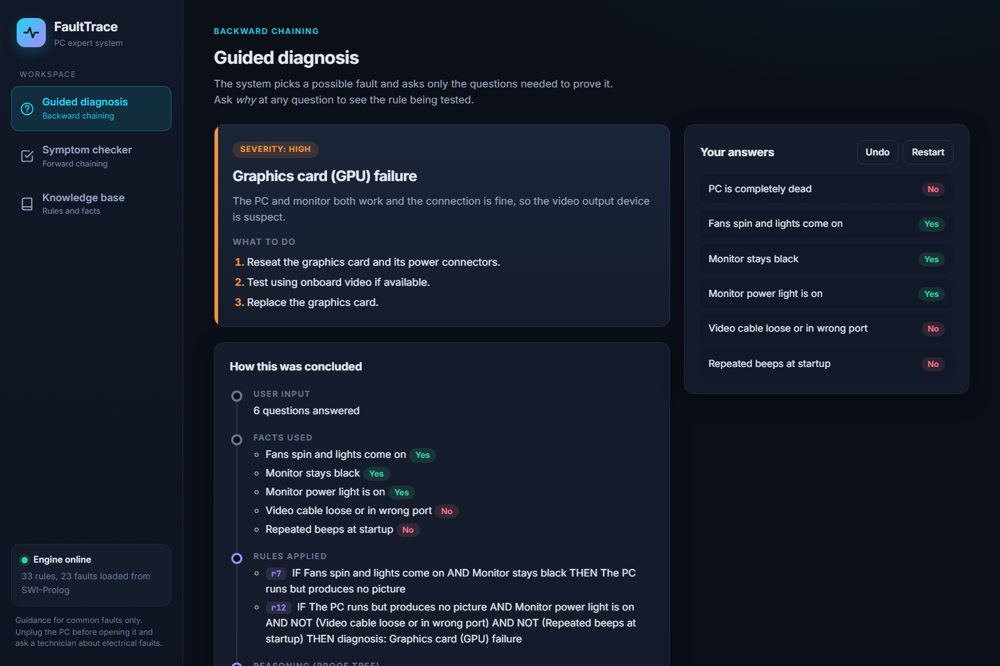
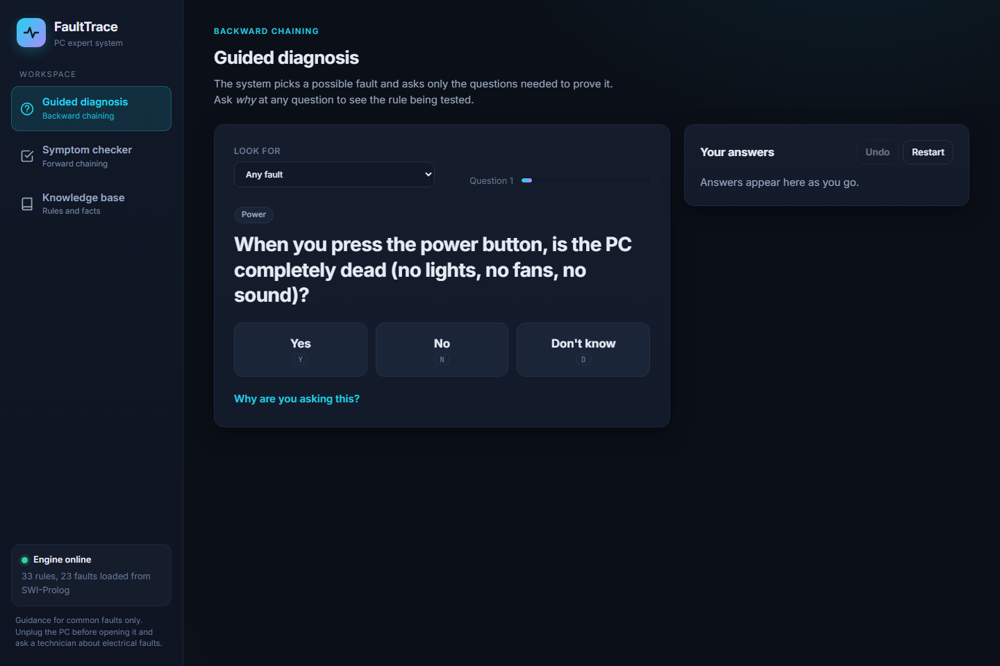
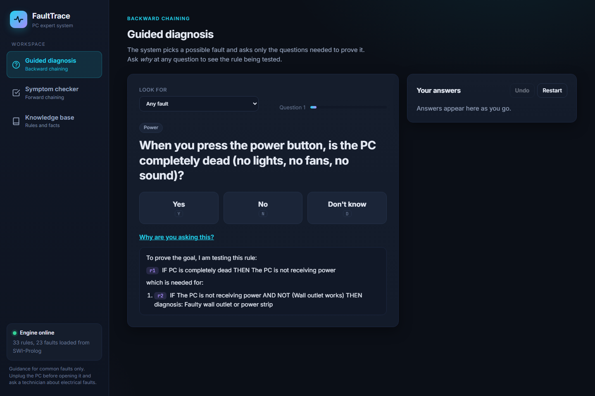
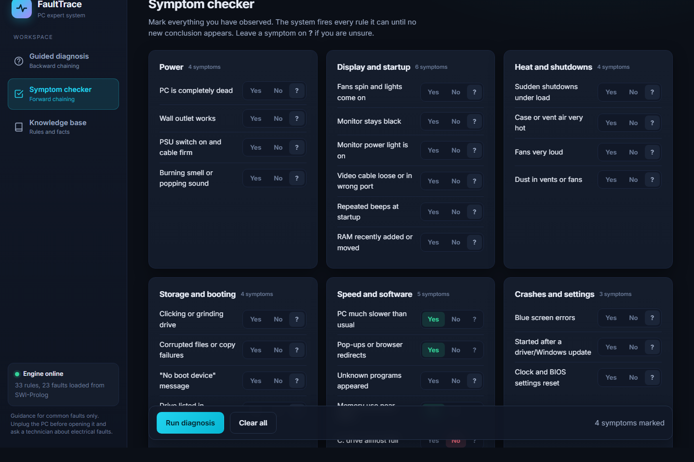
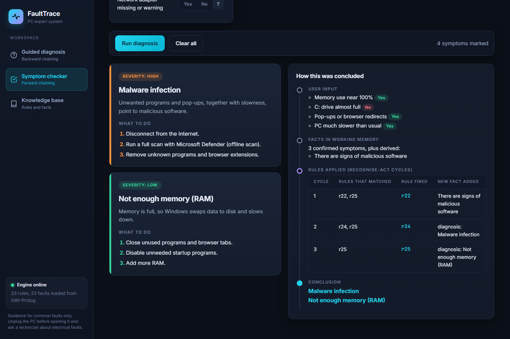
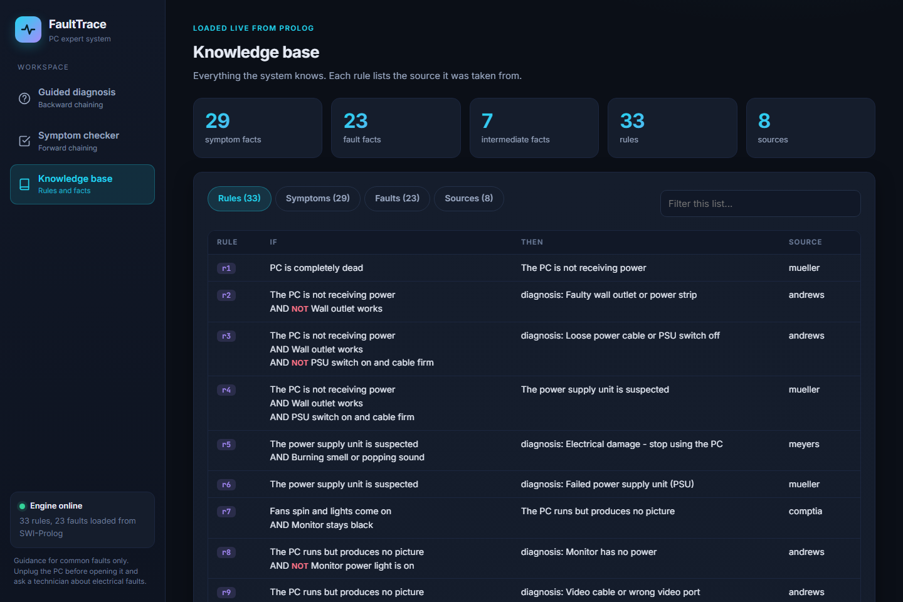

# FaultTrace — PC Troubleshooting Expert System

A rule-based expert system that diagnoses common desktop PC problems (power, display,
overheating, storage, performance, crashes and network faults) and **explains how it reached
each conclusion** — every answer traces back through the exact rules that fired.



## Architecture

```
HTML + CSS + JavaScript   (frontend/)   user interface in the browser
          |
       FastAPI            (backend/)    passes requests to Prolog as JSON
          |
      SWI-Prolog          (prolog/)     inference engine: forward + backward chaining
          |
  Expert system rules     (prolog/kb.pl) 29 symptom facts, 23 fault facts, 33 rules
```

FastAPI does no reasoning of its own. For every request it starts SWI-Prolog with
`prolog/bridge.pl`, sends the request as JSON on standard input, and returns Prolog's JSON
reply to the browser.

## Features

- **Guided diagnosis (backward chaining).** The system picks a possible fault and asks only the
  questions needed to prove or rule it out, one at a time. Click *Why are you asking this?* to
  see the exact rule being tested. Use the *Look for* menu to target one specific fault instead
  of searching for any.
- **Symptom checker (forward chaining).** Mark every symptom you've observed and run the
  diagnosis in one pass. The system fires every rule it can — shown as a table of
  recognise–act cycles: which rules matched, which one fired, and the new fact it added —
  until no new conclusion appears.
- **Full explanation trace.** Every diagnosis shows the user input, the facts used, the rules
  applied (with source references), the reasoning/proof tree, and repair steps ranked by
  severity.
- **Live knowledge base browser.** Every rule, fact and source reference, loaded straight from
  the Prolog knowledge base and filterable in the UI.

## Screenshots

| Guided diagnosis | Why-this-question |
|---|---|
|  |  |

| Symptom checker | Symptom checker result |
|---|---|
|  |  |

| Knowledge base |
|---|
|  |

## 1. Required software

| Software | Version | Download |
|---|---|---|
| SWI-Prolog | 9.x (8.x also works) | https://www.swi-prolog.org/download/stable |
| Python | 3.10 or newer | https://www.python.org/downloads/ |
| A web browser | Chrome, Edge or Firefox | |

Python dependencies (installed in step 2.3): `fastapi`, `uvicorn`.

## 2. Installation

1. **Install SWI-Prolog.** On Windows, run the installer and tick *"Add swipl to the system PATH"*.
   Check it works: open a new Command Prompt and type `swipl --version`.
2. **Install Python.** On Windows, tick *"Add python.exe to PATH"* in the installer.
3. **Install the Python packages.** Open a terminal in the project folder (`pc-expert-system`) and run:
   ```
   pip install -r backend/requirements.txt
   ```

## 3. Running the system

From the project folder:

```
uvicorn backend.main:app --reload
```

Then open **http://127.0.0.1:8000** in your browser. Press `Ctrl + C` in the terminal to stop the server.

If you see *"SWI-Prolog (swipl) was not found"*, set the path manually and run again, for example on Windows:

```
set SWIPL=C:\Program Files\swipl\bin\swipl.exe
uvicorn backend.main:app --reload
```

### Running with Docker

```
docker build -t fault-trace .
docker run -p 8000:8000 fault-trace
```

Then open **http://127.0.0.1:8000**.

### Running without the web interface (Prolog console)

```
cd prolog
swipl console.pl
?- start.
```

Answer with `yes.`, `no.`, `unknown.` or `why.` (each followed by a full stop).

### Running the test cases

```
python tests/run_tests.py
```

This runs 20 test cases through both inference methods and writes the results to `tests/test_results.md`.

## 4. Using the interface

**Guided diagnosis (backward chaining).** The system asks one question at a time. Click *Yes*, *No* or
*Don't know*. Click *Why are you asking this?* to see the rule being tested. Use the *Look for* menu to test
one specific fault instead of any fault. When a diagnosis is reached, the page shows the fault, the repair
steps and a trace: user input, facts used, rules applied, the proof tree and the conclusion.

**Symptom checker (forward chaining).** Mark each observed symptom *Yes* or *No* (leave *?* when unsure)
and click *Run diagnosis*. The system shows every diagnosis it can derive and a table of recognise-act
cycles: which rules matched, which rule fired and the new fact it added.

**Knowledge base.** Lists every rule (IF / THEN / source), every fact and all references.

## 5. Example

**Guided diagnosis** — six yes/no answers reach a diagnosis with full severity, repair steps and
proof trace:

| Question | Answer |
|---|---|
| Is the PC completely dead? | No |
| Do the fans spin and lights come on? | Yes |
| Does the monitor stay black? | Yes |
| Is the monitor's power light on? | Yes |
| Is the video cable loose or in the wrong port? | No |
| Repeated beeps at startup? | No |

Output: **Graphics card (GPU) failure**, severity high. Rules applied: r7 (PC runs but no picture) then r12
(monitor on, cable fine, no beeps, so the GPU is suspect). See [guided-result.png](docs/screenshots/guided-result.png).

**Symptom checker** — mark PC much slower = Yes, Pop-ups = Yes, Memory near 100% = Yes, C: drive full = No.

Output: **Malware infection** and **Not enough memory (RAM)**, reached through recognise-act cycles r22,
r24, r25. See [symptom-result.png](docs/screenshots/symptom-result.png).

## 6. Project structure

```
pc-expert-system/
  prolog/kb.pl         knowledge base: facts, rules, references
  prolog/engine.pl     inference engine: backward chaining, forward chaining, explanations
  prolog/bridge.pl     JSON link between FastAPI and the engine
  prolog/console.pl    text interface inside SWI-Prolog
  backend/main.py      FastAPI server
  frontend/index.html  page shell (sidebar + 3 views)
  frontend/css/        base (tokens), layout, components, views
  frontend/js/         core (state, API, helpers), guided, checker, kb, main
  tests/run_tests.py   automated test cases
  docs/screenshots/    README screenshots
```

## 7. Disclaimer

The system gives guidance for common faults only. Always unplug a PC before opening it, and consult a
qualified technician for electrical faults.
